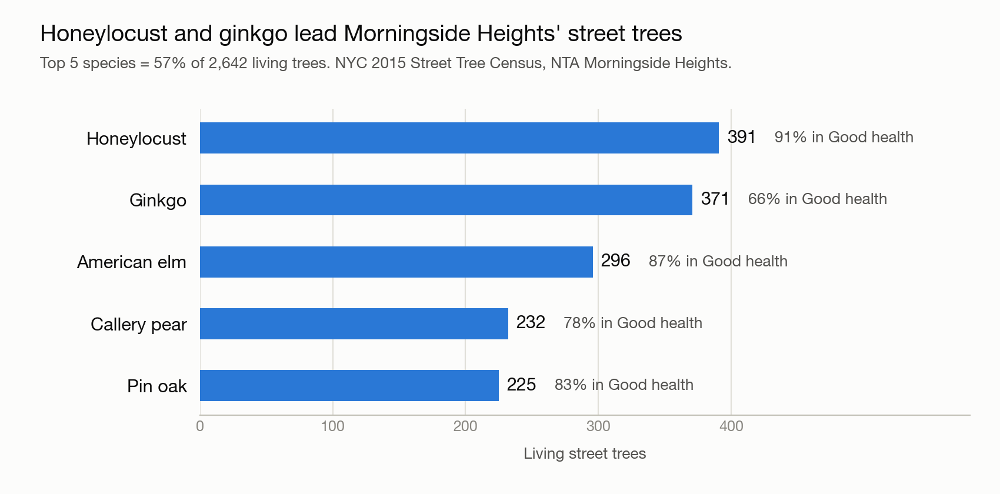

# ieor-helloworld

Example analytic prompt output from agent harness like Claude Code

This repo holds the complete output of a single prompt given to Claude Code: a small, reproducible analysis of street trees in Morningside Heights (the neighborhood around Columbia University) using the NYC 2015 Street Tree Census.



## Run it on demand

The analysis can be run on GitHub's servers from the **Actions** tab, with nothing to install:

1. Open the [**Run analysis** workflow](https://github.com/hwei-regn/ieor-helloworld/actions/workflows/run-analysis.yml).
2. Click **Run workflow**. Leave "Re-download the data from NYC Open Data" unticked to use the copy in this repo, or tick it to pull the data fresh from the API.
3. After about a minute, open the new run. The full report is on the run's summary page, and the chart plus `report.txt` are under **Artifacts** as `morningside-trees-results`.

GitHub only shows the **Run workflow** button to people with write access to the repo. Everyone else can fork this repo, enable Actions in the fork (Actions tab), and run the same workflow there, or [run the script locally](#reproduce-it).

## The original prompt

Everything in this repo was produced from this prompt, given verbatim:

> Using the NYC 2015 Street Tree Census (NYC Open Data dataset uvpi-gqnh), analyze street trees in Morningside Heights, the neighborhood around Columbia University.
>
> 1. Load the data and filter to Morningside Heights; report row count and any data quality issues.
> 2. What are the 5 most common species, and what share of trees is in "Good" health?
> 3. Make one chart and save it.
> 4. Save code as analysis.py and write a 5-sentence summary in findings.md.

## Results at a glance

| Question | Answer |
|---|---|
| Rows after filtering to Morningside Heights | **2,751** (2,642 alive, 62 dead, 47 stumps) |
| Share of living trees in Good health | **78.4%** (2,071 of 2,642) |
| Same share, counting dead and stump rows in the denominator | 75.3% (2,071 of 2,751) |
| Health mix of living trees | 78.4% Good, 16.5% Fair, 5.1% Poor |

### Top 5 species (living trees)

| Rank | Species | Trees | Share of living trees | In Good health |
|---|---|---|---|---|
| 1 | Honeylocust | 391 | 14.8% | 91% |
| 2 | Ginkgo | 371 | 14.0% | 66% |
| 3 | American elm | 296 | 11.2% | 87% |
| 4 | Callery pear | 232 | 8.8% | 78% |
| 5 | Pin oak | 225 | 8.5% | 83% |

Together these five species are 57% of the 2,642 living trees. Ginkgo is the second most common tree but has by far the lowest Good-health share of the five.

The 5-sentence written summary is in [`findings.md`](findings.md).

## Data quality issues

- **Neighborhood tag is loose.** The census has no "neighborhood" column other than the Neighborhood Tabulation Area (`nta` = `MN09`, "Morningside Heights"), which is what the filter uses. But 22 rows carry the Central Park zip code `83` (all on Central Park West), and 193 rows sit south of roughly 110th Street (down to about 97th Street), which is outside the neighborhood.
- **Non-living trees have no species or health.** All 109 dead and stump rows are missing `health`, `spc_common`, `spc_latin`, `steward`, `guards`, `sidewalk` and `problems`. This is structural, not random: every living tree has all of them. Stumps are recorded with `tree_dbh = 0` (47 rows).
- **Duplicates.** No duplicate `tree_id` values and no fully duplicated rows. Six lat/lon pairs repeat, all of them different trees at the same address.
- **The string "None" is a real category.** `steward` and `guards` use the value `"None"`, which pandas silently converts to missing by default. The loader disables that so the categories are preserved.
- **Subjective, volunteer-collected ratings.** Health is a one-time 2015 visual rating, and 1,881 of the 2,751 records were collected by volunteers (727 by TreesCount staff, 143 by NYC Parks staff).

### Sensitivity check

Dropping the 193 rows south of 110th Street swaps honeylocust and ginkgo at the top, but the top five are the same five species and the Good share is 77.7% (versus 78.4%). Dropping only the 22 Central Park West rows leaves the ranking unchanged and the Good share at 78.2%. The conclusions do not depend on how strictly the boundary is drawn.

## Method notes

- **Source:** NYC Open Data, [2015 Street Tree Census, Tree Data](https://data.cityofnewyork.us/resource/uvpi-gqnh) (`uvpi-gqnh`), queried through the Socrata API with `nta = 'MN09'`.
- **Species ranking** uses living trees only, because species is not recorded for dead trees and stumps.
- **"Share in Good health"** is reported with living trees as the denominator (the headline number), and with all rows as the denominator for completeness.
- **The ~110th Street check** uses a conservative latitude cutoff (`lat < 40.800`), below which a tree is south of 110th Street at every longitude. It is a rough screen, not an exact boundary.
- **Chart:** a single-series horizontal bar chart (one color, direct labels, no legend needed), with each bar labeled by count and Good-health share.

## Files

| File | What it is |
|---|---|
| [`analysis.py`](analysis.py) | Loads the data, prints the data quality report, top species and health share, runs the sensitivity check, and saves the chart |
| [`findings.md`](findings.md) | The 5-sentence summary |
| [`morningside_top_species.png`](morningside_top_species.png) | The chart shown above |
| [`data/morningside_heights_raw.csv`](data/morningside_heights_raw.csv) | The 2,751-row extract from the Socrata API (45 columns), fetched 2026-11-09 |
| [`requirements.txt`](requirements.txt) | Python dependencies (`pandas`, `matplotlib`) |
| [`.github/workflows/run-analysis.yml`](.github/workflows/run-analysis.yml) | The on-demand GitHub Actions workflow described above |

## Reproduce it

Requires Python 3 with `pandas` and `matplotlib` (developed on Python 3.9, pandas 2.3, matplotlib 3.9).

```bash
pip install -r requirements.txt
python3 analysis.py
```

The script uses `data/morningside_heights_raw.csv` if it exists and otherwise downloads it from the NYC Open Data API. It prints the full report to the terminal and rewrites `morningside_top_species.png`. Delete the CSV to force a fresh download; the census is a fixed 2015 snapshot, so the numbers should not change.

## About this repo

The code, chart and summary were generated by [Claude Code](https://claude.com/claude-code) from the prompt above, with the numbers in this README taken from the script's output. It is meant as an example of what an agent harness produces from a single analytic prompt, so check the data quality notes before reusing any of the conclusions.

## Context: preparatory exercise for Analytics in Practice

This repo is a preparatory exercise example for **IEOR E4524, *Analytics in Practice*** (3 points), a course in the Industrial Engineering and Operations Research (IEOR) department at Columbia University's School of Engineering and Applied Science, taught by Hardeep Johar. Instructors vary by semester; for example, Spring 2027 section 002 lists Yaren Kaya.

The official course description reads:

> MSBA students only. Groups of students will work on real world projects in analytics, focusing on three aspects: identifying client analytical requirements; assembling, cleaning, and organizing data; identifying and implementing analytical techniques (statistics, OR, machine learning); and delivering results in a client-friendly format. Each project has a well-defined goal, comes with sources of data preidentified, and has been structured so that it can be completed in one semester. Client-facing class with numerous on-site client visits; students should keep Fridays clear for this purpose.
>
> Source: [Columbia Directory of Classes, IEOR E4524 section 002, Spring 2027](https://doc.sis.columbia.edu/subj/IEOR/E4524-20271-002/)

This exercise is a small, self-contained version of that workflow on a public dataset: a well-specified question with a pre-identified data source, assembling and cleaning the data (including reporting its quality problems), applying an analytical technique, and delivering the result in a reader-friendly form (a chart and a short written summary). It is meant to show how a single well-specified prompt to an agent harness turns into reproducible work product.

The course's syllabus, schedule and enrollment rules are not reproduced here. Columbia directs students to [Vergil Course Search](https://vergil.columbia.edu/vergil/) for the most detailed and current course information; the Directory of Classes page and Vergil are the authority, not this README.
